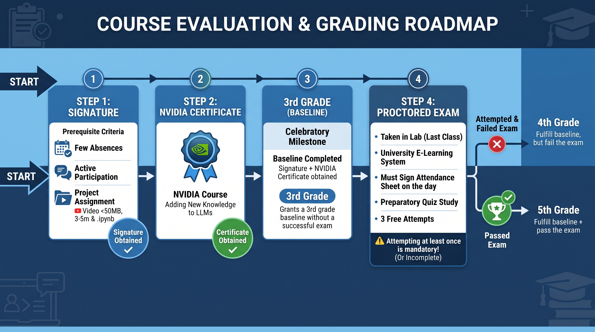

The course aims for students to gain deep knowledge of modern theoretical methods and technological implementations linked to generative methodologies. With the help of the necessary software and hardware device systems, students learn about the theoretical and practical backgrounds of the components of generative methodologies, basic generative networks in the PyTorch environment, DCGAN that also uses advanced convolution layers, GAN control, and the creation of conditional GANs. With the help of the course, students learn about advanced GAN programming in a practice-oriented way, such as data augmentation, protection of personal data, or the use of GAN applications in questionnaires. The course pays special attention to complex solutions, including measuring the comparability of generative models, realism and diversification, the detection of bias, or implementing different style transfer techniques (Pix2Pix, CycleGAN, StyleGAN). Students work on pre-agreed project tasks within the areas of generative methodology applications.

======

## [Email address of the Teacher](mailto:lakatos.robert@inf.unideb.hu)

## Consultation

- Monday / Hétfő - 11:00 - 12:00 - IK 128 (in my office)
- Tuesday / Kedd - 11:00 - 12:00 - IK 128 (in my office)

## [Attendance sheet](https://forms.cloud.microsoft/e/Ek0iSB0fjC?origin=lprLink)

## [Attendance sheet status](https://unidebhu-my.sharepoint.com/:x:/g/personal/lakatos_robert_inf_unideb_hu/IQCCnu6AtHk1TpCV4NsYwGVqASFjuU1MguAOZNI0A8oSHlY?e=B3IZ3O)

### Evaluation

- Signature: Fewer absences than allowed. Active participation in classes. Presentation of the completed project assignment, which must be submitted in video and code formats. The code consists of a single Jupyter notebook file that runs in the Google Colab environment. The video must be a single file, smaller than 50MB, with a maximum length of 3-5 minutes.
- Proctored Exam Rules & Details:
  - Prerequisites: To be eligible to take the proctored exam, students must first complete the NVIDIA course and obtain the NVIDIA certificate (Adding New Knowledge to LLMs). Students must bring this certificate with them to the exam.
  - Time and Location: The exam takes place in the laboratory room during the last class.
  - Environment: Conducted in the university's e-learning system under protected, proctored conditions.
  - Attendance: Only students who sign the attendance sheet on the day of the exam are permitted to take it.
  - Mandatory Requirement: Appearing for and attempting the proctored exam at least once is mandatory. Failure to do so will result in an incomplete course.
  - Attempts: The proctored exams associated with the NVIDIA course can be attempted 3 times for free.
  - Preparation: A preparatory quiz is provided for the proctored exam; studying it thoroughly ensures a successful exam.
- Grading System:
  - 3rd grade: Obtaining the signature AND successfully obtaining the NVIDIA certificate.
  - 4th grade: Fulfilling the baseline requirements (signature + NVIDIA certificate), but failing the proctored exam.
  - 5th grade: Fulfilling the baseline requirements and successfully passing the proctored exam.

### Course Path

## Registration form to NVIDIA certificate (Adding New Knowledge to LLMs)

- [Adding New Knowledge to LLMs - 11/14/2026 9:00 AM – 11/14/2026 5:00 PM](https://forms.gle/8xpgHWRJ4gZdUEtRA)
- [Adding New Knowledge to LLMs - 11/15/2026 9:00 AM – 11/14/2026 5:00 PM](https://forms.gle/DPovqTCB19G7Z9MPA)
- [Adding New Knowledge to LLMs - 11/28/2026 8:00 AM – 11/28/2026 4:00 PM](https://forms.gle/mqmfiVb21cxDUoH59)

**Important: If someone obtains the NVIDIA certificate but does not obtain a university certificate, it is still only a 3rd grade. You cannot skip a level!**

### Project Rules

- Create a working application, solve a real problem, and present it as a video using the solutions and models learned in class. 
- The code of the working application consists of a single Jupyter notebook file that runs in the Google Colab environment. 
- You must use Python programing language.
- You can work in teams (2-4 people) or work individually.

### Submission

- **Submission deadline: 2026.12.04. 24:00 (Friday)**
- [**Submission form (CLOSED)**](https://forms.cloud.microsoft/e/u4Q3wsmvxb?origin=lprLink)
     - Mandatory fields: Neptun code, Video link, Source link.
     - If there are more than one of you, the Neptun code can be entered as a list separated by commas.
     - The Source link contains the source code.
     - The Video link contains the video code.
     - If two are the same, the same must be entered in both places.
     - If there are no exceptional obstacles, please allow (chose **'yes'** on the form) your submitted work to be shared among the students of the following semesters within the framework of the subject.

## Labor

- I.    [Neural Network](https://colab.research.google.com/drive/1SrdiqJt9UvF81rpKpF_xaNF9_GxbPpn5)
- II.   [Convolutional Neural Network](https://colab.research.google.com/drive/1B_es4Se1Y33Jxl2aKuTqzw0y8pgZBjwZ)
- III.  [U-Net](https://colab.research.google.com/drive/1aYC0B7eTiRn2AYEhRkzQm-bhq0986BFs)
- IV.   [Diffusion Model](https://colab.research.google.com/drive/1MCEA8eQFczoULia1nld4XO6ZUuWbCzBB)
- V.    [Optimizations](https://colab.research.google.com/drive/11zVZVmNvCtSuUohVYpcEL1yr_Qp9iw49)
- VI.   [Classifier Free Diffusion](https://colab.research.google.com/drive/1gtX3GO2zviz9N66Xa1ubxINULqNzUYld)

## Recommended Literatures and Courses

[Jakub Langr and Vladimir Bok: GANs in Action, Manning, 2019.](https://www.amazon.com/GANs-Action-learning-Generative-Adversarial/dp/1617295566)
[David Foster: Generative Deep Learning, Oreilly, 2019.](https://www.oreilly.com/library/view/generative-deep-learning/9781492041931/)
[Kailash Ahirwar: Generative Adversarial Networks Projects, Packt, 2019.](https://www.amazon.com/Generative-Adversarial-Networks-Projects-next-generation/dp/1789136679)
[I. Goodfellow, Y. Bengio, A. Courville: Deep Learning, MIT Press, 2016.](https://www.deeplearningbook.org/)
[Stuart Russell and Peter Norvig: Artificial Intelligence: A Modern Approach, 4th US ed., Pearson, 2020.](https://aima.cs.berkeley.edu/)